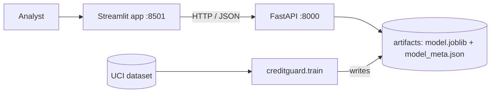

# CreditGuard: credit card default risk scorer

[](https://github.com/krishjagad156-del/creditguard/actions/workflows/ci.yml)

An end-to-end machine learning project: public data, a leakage-safe training pipeline, a FastAPI service, a Streamlit app, Docker Compose, and automated tests.

The model estimates the probability that a credit card customer will miss their next payment, so a credit risk analyst can review risky accounts early. It is **decision support, not an automated lending decision.**

> **Status:** runs locally with one Docker command (see Quick start). It is **not deployed publicly**; see "Deployment status" below. Every number in this README comes from a real run on the UCI data.

## Screenshots

| Assess a customer | Model performance |
|---|---|
|  |  |

| API documentation | Containers running |
|---|---|
|  |  |

## The problem

| | |
|---|---|
| Users | Credit risk analysts at a card issuer |
| Task | Binary classification: will the customer default next month? |
| Data | UCI *Default of Credit Card Clients*: 30,000 customers, Taiwan, April to September 2005, **22.1% defaulted** |
| Output | A calibrated default probability, a risk level compared with the average customer, and a review flag that depends on a chosen operating point |
| Fairness decision | `SEX`, `AGE` and `MARRIAGE` are **not model inputs**. They are used only to audit error rates by group, and the API rejects them |

Because only 22% of customers default, accuracy is misleading (predicting "no default" for everyone is 78% accurate). The project uses PR-AUC, calibration (Brier score), and cost-aware thresholds instead.

## Architecture



Model inference lives only in the API. The app never loads the model.

## Results

All results below are from a held-out test set of 6,000 customers, touched once, after every decision was made on training data only.

| Metric | Value | Context |
|---|---|---|
| ROC-AUC | **0.781** | 0.5 = random |
| PR-AUC | **0.560** | 0.221 = random (the default rate) |
| Brier score | **0.1345** | 0.172 if every customer were given the average 22.1% |
| Calibration | Close to the diagonal | Predicted risk matches observed default rates across bins |

### Model comparison (5-fold stratified CV, training set only)

| Model | CV PR-AUC | CV ROC-AUC |
|---|---|---|
| Baseline (predict the default rate) | 0.2212 | 0.5000 |
| Logistic regression | 0.5101 | 0.7571 |
| Logistic regression + one-hot repayment status | 0.5429 | 0.7712 |
| Random forest | 0.5586 | 0.7860 |
| **Gradient boosting (selected)** | **0.5623** | 0.7860 |

Gradient boosting and random forest are effectively tied: the PR-AUC gap is 0.004, about half the fold-to-fold standard deviation (0.007 to 0.008). Gradient boosting was selected as the nominal leader.

### Operating points: turning probabilities into flags

How many customers to flag is a **business decision**, so the app lets the user choose. Every threshold was chosen on out-of-fold training predictions. The test set only reports what each setting achieved.

| Operating point | Threshold | Customers flagged | Defaulters caught (recall) | Flagged who default (precision) |
|---|---|---|---|---|
| Review top 10% | 0.572 | 10.3% | 32.6% | 69.7% |
| Cost ratio 2:1 | 0.350 | 18.7% | 48.8% | 57.7% |
| Review top 20% | 0.335 | 19.6% | 50.0% | 56.5% |
| Cost ratio 3:1 | 0.250 | 26.2% | 59.0% | 49.7% |
| Review top 30% | 0.226 | 29.5% | 62.0% | 46.5% |
| **Cost ratio 5:1 (default)** | 0.150 | 49.0% | 78.1% | 35.3% |
| Cost ratio 10:1 | 0.080 | 79.3% | 95.0% | 26.5% |

"Cost ratio r:1" means a missed default is assumed to cost r times an unnecessary review. **These ratios are assumptions, not measured costs.** For a calibrated model the optimal cut-off is about 1/(1+r), and the thresholds above match that closely (for example 0.25 for 3:1), which supports the calibration.

At the default (5:1) setting the confusion matrix is 1,037 true positives, 1,901 false positives, 290 false negatives and 2,772 true negatives.

## Experiments

Every variant used the same folds, so differences are compared fold by fold (CV on the training set; test set untouched).

| Model | Variant | CV PR-AUC | CV ROC-AUC | PR-AUC change vs current | Folds better |
|---|---|---|---|---|---|
| Logistic regression | raw columns only | 0.5078 | 0.7265 | -0.0023 (spread 0.0068) | 2 of 5 |
| Logistic regression | engineered (current) | 0.5101 | 0.7571 | 0 | n/a |
| Logistic regression | engineered + PAY one-hot | 0.5429 | 0.7712 | **+0.0328** (spread 0.0069) | **5 of 5** |
| Gradient boosting | raw columns only | 0.5582 | 0.7803 | -0.0041 (spread 0.0033) | 1 of 5 |
| Gradient boosting | engineered (current) | 0.5623 | 0.7860 | 0 | n/a |
| Gradient boosting | engineered + PAY one-hot | 0.5625 | 0.7856 | +0.0002 (spread 0.0028) | 2 of 5 |

Five folds is a small sample, so these are indications, not proof.

- Repayment status is not a straight line (status -1 defaults slightly more than 0). A linear model gains 0.033 PR-AUC in every fold when it is one-hot encoded, closing about 63% of its gap to gradient boosting. Trees handle this shape on their own.
- Engineered features add a small gain for gradient boosting (about 0.004 PR-AUC, better in 4 of 5 folds) and clearly help the logistic model's ROC-AUC. They are cheap, so they stay.
- **Tuning.** A randomized search over 12 gradient-boosting settings reached a CV PR-AUC of 0.5619 against 0.5623 untuned. The acceptance rule (set before the run) required a gain above 0.0077, the fold-to-fold spread, so the untuned model was kept. Random forest, untuned and tuned boosting all land near 0.56, so the ceiling is set by the information in the data, not by hyper-parameters.

## Error analysis

Where the model is wrong (test set, default operating point):

- **97.6% of the 290 missed defaulters looked current** (most recent repayment status 0 or better). The model is excellent on customers who are already late (status 2 or worse: 100% recall) and weak on a sudden default from someone who looks fine. About half of all defaulters fall in that "looks current" group, and the model catches about 58% of them.
- The ten most confidently missed defaulters all have high credit limits, clean repayment records and normal bills. Nothing in this dataset signals risk for them.
- The most confident false alarms all have two or more months of delay. That is expected: in that group about 32% do not default, which is what calibration means.
- Predicted and observed default rates agree within each repayment-status segment (for example 69.7% predicted vs 68.2% observed at status 2).
- **Credit limit drives flags**: the lowest-limit fifth is flagged 82% of the time and the highest fifth 26%. Low-limit customers do default more (31% vs 16.5%), but limit can also act as a proxy for wealth.
- Customers with a credit balance (a negative bill) are scored worse: 55% recall against 80% for the rest, on 377 customers. The cause is not established.

## Fairness audit

`SEX`, `AGE` and `MARRIAGE` are not model inputs. They are used only here, to measure error rates by group at the default threshold on the test set.

| Group | Customers | Flagged | Recall | False-positive rate |
|---|---|---|---|---|
| Women | 3,598 | 47.3% | 77.5% | 39.2% |
| Men | 2,402 | 51.4% | 79.0% | 43.0% |
| Age under 30 | 1,912 | 52.4% | 80.8% | 44.2% |
| Age 30 to 39 | 2,198 | 45.4% | 75.9% | 37.5% |
| Age 40 to 49 | 1,341 | 48.6% | 77.9% | 39.7% |
| Age 50+ | 549 | 52.3% | 77.8% | 44.0% |

The largest gap is by age: customers under 30 who do not default are wrongly flagged more often than those aged 30 to 39 (44% vs 38%). The gap by sex is smaller. Removing a column does not guarantee fairness, because other inputs can act as proxies. This table **describes** gaps and does not certify the model as fair. Marital-status groups are too small to interpret reliably and are omitted here (see `model_meta.json`).

## Quick start with Docker

Needs Docker Desktop. The trained model is committed, so no training is required.

```bash
git clone https://github.com/krishjagad156-del/creditguard.git
cd creditguard
docker compose up --build
```

- App: http://localhost:8501
- API docs: http://localhost:8000/docs
- Stop with Ctrl+C, then `docker compose down`

```bash
docker compose ps                 # both services should be healthy
docker compose logs api           # inspect logs
```

## Local development (Windows)

```bat
python -m venv .venv
.venv\Scripts\activate
pip install -r requirements.txt

python scripts/download_data.py          :: downloads the UCI data to data/raw/
jupyter lab notebooks/01_eda.ipynb       :: exploratory analysis
python -m creditguard.train              :: trains, evaluates and saves the model (add --tune for the search)

uvicorn creditguard.api.main:app --reload
streamlit run ui/app.py

python -m pytest -q
python -m creditguard.threshold_analysis
python -m creditguard.experiments
python -m creditguard.error_analysis
```

On macOS or Linux, activate with `source .venv/bin/activate`. Tested on Python 3.12.

## API

| Endpoint | Purpose |
|---|---|
| `GET /health` | `ok` when the model is loaded, `degraded` otherwise |
| `GET /operating-points` | The menu of flag thresholds with their test-set results |
| `GET /model-info` | Metrics, comparison, calibration, fairness audit |
| `POST /predict` | Validated input to probability, risk level and review flag. Optional `?threshold=0.25` |

```bash
curl -X POST http://localhost:8000/predict -H "Content-Type: application/json" -d @sample_request.json
```

Status codes: `200` success, `422` invalid input (out-of-range values, missing fields, or audit-only fields such as `AGE`), `503` model not loaded, `500` unexpected error.

`risk_band` compares the customer with the average customer in the training data (below 0.5x, up to 1.5x, up to 3x, or more than 3x the average default rate) and does not change with the operating point. `flagged_for_review` does. The 0.5x, 1.5x and 3x cut-points are an assumption chosen for readability, not learned from data.

## How it is built

1. **Split first.** A stratified 20% test set (`random_state=42`) is set aside before any modelling.
2. **Pipeline.** Feature engineering (utilisation, payment ratios, delay statistics, trends, a negative-bill flag) is row-wise and stateless. Imputation, scaling and one-hot encoding are fit inside a scikit-learn `Pipeline`, so they only learn from training folds.
3. **Compare** models with 5-fold stratified CV on the training set, selecting on PR-AUC.
4. **Calibrate** probabilities (sigmoid, cross-validated).
5. **Operating points** are chosen on out-of-fold training predictions only.
6. **Evaluate once** on the test set, then run the fairness audit, error analysis and permutation importance.

Data decisions, confirmed in the EDA notebook: EDUCATION codes 0, 5 and 6 (undocumented) are folded into "other" because their default rates (0% to 16%) resemble code 4 (5.7%), not codes 1 to 3 (19% to 25%); 35 duplicate rows are kept because there is no customer ID and most are all-zero accounts (7 of 6,000 test rows also appear in training).

## Repository layout

```
creditguard/        package: config, data, features, evaluation, train, experiments, error_analysis, threshold_analysis
creditguard/api/    FastAPI app, Pydantic schemas, model service
ui/app.py           Streamlit front end
scripts/            download_data.py
notebooks/          01_eda.ipynb
tests/              pytest suite (API, features, training, analyses, UI smoke tests)
artifacts/          trained model and metadata
reports/            figures and analysis tables
requirements/       pinned dependencies split by purpose
Dockerfile.api  Dockerfile.ui  docker-compose.yml
.github/workflows/  CI: runs the tests on every push
```

## Deployment status

The project is **not deployed to a public URL.** The services run locally with Docker Compose. The code is prepared for a cloud host: the Dockerfiles honour the `PORT` variable that hosts inject, and the app waits for a sleeping API to wake instead of failing.

Options I compared (free-tier terms change often, so check before relying on any of this): Render's free web services spin down when idle; Google Cloud Run needs a billing account even for its free allowance; Streamlit Community Cloud can host only the app; and Hugging Face's documentation states that Docker Spaces require a paid plan.

## Limitations and responsible use

- 2005 Taiwan data. The model is not validated for any other market or period.
- It cannot see sudden defaults from customers who look current: that is where almost all of its misses come from.
- The cost ratios behind the operating points are assumptions, not measured costs.
- `EDUCATION` remains an input and can act as a socioeconomic proxy; credit limit strongly drives flags and may proxy for wealth.
- Removing `SEX`, `AGE` and `MARRIAGE` does not guarantee fairness. The audit shows a gap by age that deserves attention before any real use.
- Predictions are estimates, never guarantees, and must not be the sole basis for a lending decision.

## Data license and credit

Yeh, I-Cheng (2009). *Default of Credit Card Clients* [Dataset]. UCI Machine Learning Repository. https://doi.org/10.24432/C55S3H. Licensed CC BY 4.0. See `data/README.md`.

Code license: MIT (see `LICENSE`).
